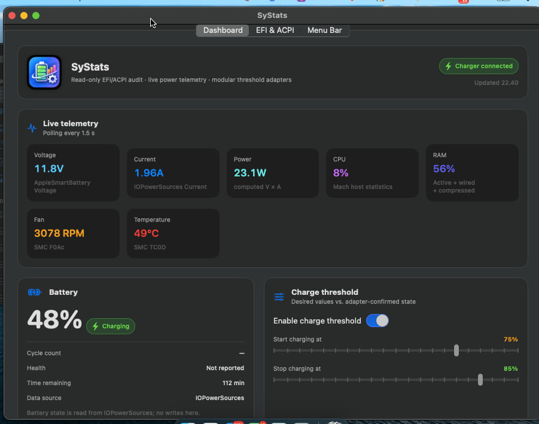
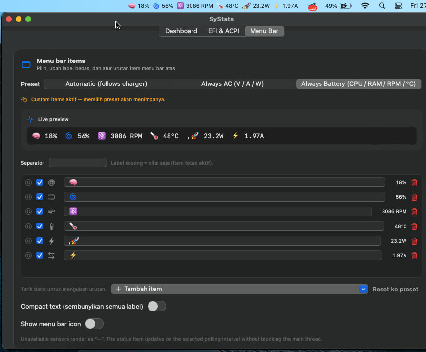

# SyStats

<div align="center">

### Native macOS telemetry & charge-threshold control for Hackintosh

[](https://github.com/Syuhadak27/SyStats/actions/workflows/build-release.yml)
[](https://github.com/Syuhadak27/SyStats/releases)
[](https://github.com/Syuhadak27/SyStats)
[](LICENSE)

**Read-only EFI/ACPI audit · live power telemetry · modular charge-threshold adapters · fully customizable menu bar**

</div>

---

## Screenshots

<table>
  <tr>
    <td width="50%"></td>
    <td width="50%"></td>
  </tr>
  <tr>
    <td align="center"><b>Charger connected</b> — V / A / W dari baterai + adapter</td>
    <td align="center"><b>On battery</b> — CPU / RAM / Fan / Temperature</td>
  </tr>
  <tr>
    <td width="50%"></td>
    <td width="50%"></td>
  </tr>
  <tr>
    <td align="center"><b>Menu Bar editor</b> — label bebas, checklist, drag-urutan</td>
    <td align="center"><b>Menu bar + popover</b> — telemetry ringkas & kontrol cepat</td>
  </tr>
</table>

<details>
<summary>Kondisi sebelum perbaikan pembacaan sensor (V/A/W masih <code>—</code>)</summary>


</details>

---

## Fitur utama

- **Audit EFI/ACPI read-only** — memindai `.aml`/`.dsl` & `config.plist`, mengindeks tabel/perangkat dan method terkait battery, EC, thermal, fan, SMC. File EFI **tidak pernah ditulis**.
- **Telemetri live** — Voltage / Current / Power, CPU %, RAM %, Fan RPM, Temperature °C, dan status baterai (%, charging, cycle, health, time remaining).
- **Menu bar sepenuhnya milik user** — pilih item mana saja, ganti label teks bebas (emoji boleh), checklist aktif/nonaktif, drag untuk urutan, separator bebas, preset cepat AC/Battery/Automatic. Lihat screenshot editor di atas.
- **Charge threshold modular** — Start/Stop via YogaSMC/ThinkVPC (ACPI `BCCS`/`BCSS`), VirtualSMC read-only, atau external helper. Tidak pernah mengklaim sukses bila interface menolak.
- **Ringan** — polling IOKit/SMC di queue utility; UI tidak render ulang seluruh halaman tiap update; material/blur digunakan seminimal mungkin.

> Build & release sepenuhnya via GitHub Actions pada runner macOS. Tidak perlu build lokal.

---

## 1. Struktur & aset

```
.
├── Sources/              # semua file Swift
├── images/               # screenshot untuk README
├── Assets.xcassets/      # AppIcon + MenuBarIcon
├── Config/Info.plist     # Info.plist manual (dipakai project.yml)
├── project.yml           # spesifikasi XcodeGen
├── .github/workflows/    # build & release otomatis
└── EFI/                  # REFERENSI LOKAL SAJA — diabaikan git
```

| Aset | Keterangan |
|---|---|
| `icon.png` | Ikon aplikasi (AppIcon). |
| `menu_bar.png` | Glif menu bar (template image, monochrome, tajam di wallpaper terang/gelap). |
| `images/*.jpg` | Screenshot dashboard, menu bar editor, dan popover. |

Ganti ikon cukup dengan menimpa `icon.png` lalu regenerate `menu_bar.png`, atau pilih path custom di tab **Menu Bar → Assets**. Aplikasi tidak crash bila path berubah; fallback ke aset bundle.

Folder `EFI/` hanya contoh referensi dan **sengaja tidak ikut version control** (lihat `.gitignore`).

---

## 2. Arsitektur kode

Semua kode ada di satu folder `Sources/` agar ringkas:

- `SyStatsApp.swift`, `AppEnvironment.swift`, `AppState.swift` — entry & state bersama.
- `AppDelegate.swift`, `MenuBarController.swift`, `MainWindowController.swift` — jembatan AppKit (`NSStatusItem`, popover, jendela utama yang bisa dibuka ulang setelah ditutup).
- `Telemetry*.swift`, `SMCReader.swift`, `PowerSourceReader.swift`, `SystemMonitor.swift`, `SensorReader.swift` — pembacaan sensor.
- `MenuBarItem.swift` — model item menu bar yang bisa diatur user.
- `ACPIInspector.swift`, `ACPIParser.swift`, `EFIDetector.swift` — audit EFI (read-only).
- `YogaSMCBridge.swift`, `ThresholdAdapters.swift`, `ThresholdController.swift` — jembatan ThinkVPC/EC + adapter write threshold.
- `DashboardView.swift`, `InspectorView.swift`, `PreferencesView.swift`, `MenuBarPopoverView.swift`, `UIComponents.swift`, dll — GUI.

Pemisahan penting:

- **Audit (baca)**: `ACPIInspector` hanya membaca `.aml`/`.dsl` dan `config.plist`.
- **Runtime write**: `ThresholdController` → `ThresholdAdapting`. Method ACPI di AML **tidak** otomatis bisa dipanggil dari userspace macOS; status ini ditampilkan terpisah di GUI.
- **Render isolation**: telemetry & threshold tidak diteruskan ke `AppState.objectWillChange`, sehingga halaman Preferences (tempat TextField diedit) tidak ikut render ulang tiap poll.

---

## 3. Deteksi EFI & scan ACPI

`EFIDetector` mencoba (berurutan): path tersimpan → `/Volumes/EFI/EFI` → `/Volumes/EFI` → `/Volumes/ESP/EFI` → `/Volumes/ESP` → `~/Desktop/EFI` → `~/EFI` → `EFI` relatif.

Folder ACPI yang dipindai: `EFI/OC/ACPI`, `EFI/APPLE/ACPI`, `EFI/ACPI` (semua yang ada).

Untuk setiap `.aml`: header ACPI 36 byte diparse persis (signature, length, revision, OEMID, OEMTableID), lalu **heuristic ASCII token scan** (AML NamePath menyimpan segmen ASCII 4 karakter). Untuk `.dsl`: regex deklarasi `Device/Method/Name/OperationRegion/Field`. Kategori: battery, EC, thermal, fan, SMC, power management. Setiap temuan diberi label sumbernya.

`config.plist` dibaca untuk mengetahui kext yang benar-benar **Enabled** (VirtualSMC, SMCBatteryManager, SMCProcessor, SMCSuperIO, YogaSMC, ECEnabler, VoodooSMBus). Jika tidak terbaca, status **Unknown**, bukan dikira-kira.

---

## 4. Telemetri & keterbatasan jujur

| Data | Sumber | Catatan |
|---|---|---|
| Baterai %, charging, cycle, health | `IOPowerSources` | API publik macOS |
| Voltage / Current / Power | `kIOPSVoltageKey`/`kIOPSCurrentKey` → `AppleSmartBattery` (`Voltage`, `InstantAmperage`/`Amperage`) → kandidat SMC (`VDCR`, `B0AV`, `PDTR`, `PPBR`, …) → adapter watt | **Perbaikan v1.1.0**: dulu memakai string literal `"Voltage"`/`"Current"` sehingga selalu `—` di Hackintosh. Sekarang terbaca (lihat screenshot). |
| CPU % | `host_statistics(HOST_CPU_LOAD_INFO)` | Delta antar sampling |
| RAM % | `host_statistics64(HOST_VM_INFO64)` | active + wired + compressed / total |
| Fan RPM | SMC `FNum`, `F0Ac`…`F4Ac` | Bergantung SMCSuperIO/YogaSMC |
| Suhu °C | SMC `TC0D`, `TC0P`, `TN0P`, `TC0c` | Umum di Intel Mac; tidak di Apple Silicon |

### Arti V / A / W saat charger terpasang

Nilai yang ditampilkan adalah **daya & arus baterai**, bukan konsumsi sistem:

- `V` = tegangan **baterai** (mV → V), bukan tegangan adapter.
- `A` = arus **baterai** (mA → A). Konvensi Apple: negatif = charging (masuk baterai), positif = discharging.
- `W` = `V × |A|` = daya yang masuk/keluar baterai. Bisa ≈ 0 saat baterai penuh / threshold stop, meski charger tetap colok.

Fallback `PDTR` (SMC) dan `IOPSCopyExternalPowerAdapterDetails()` dipakai hanya bila `V × A` tidak bisa dihitung. Tidak ada angka rekaan: sumber selalu ditampilkan di tile (mis. `AppleSmartBattery Voltage`, `IOPS Current`, `computed V × A`).

Pembacaan SMC/IOKit dijalankan di queue utility, bukan di callback timer main thread.

---

## 5. Menu bar customization

Tab **Menu Bar** (lihat screenshot) menyediakan:

- **Preset cepat**: `Automatic (follows charger)`, `Always AC (V/A/W)`, `Always Battery (CPU/RAM/RPM/°C)`. Memilih preset menimpa daftar item.
- **Daftar item**: centang aktif/nonaktif, `TextField` label bebas — boleh kosong (nilai tetap tampil tanpa label) atau emoji (contoh screenshot memakai 🪫, 🌀, 🧠, 🌡️, 🚀, ⚡).
- **Drag reorder** lewat `.onMove` di `List`.
- **Separator bebas** (default satu spasi).
- **Compact text**: sembunyikan semua label tanpa menghapus data user.
- **Live preview** dari telemetri aktual (bukan data contoh), diisolasi di subview agar tidak merender ulang editor saat polling.

Item tersedia: Voltage, Current, Power, CPU, RAM, Fan, Temperature, Battery. Tidak ada batas jumlah item.

---

## 6. Charge threshold — mengikuti pola BatteryLenovoAssistent

Mekanisme diadaptasi dari audit repo [Syuhadak27/BatteryLenovoAssistent](https://github.com/Syuhadak27/BatteryLenovoAssistent) (YogaSMC 1.5.3). **Threshold bukan SMC key** (`B0St/B0Sp/B0En/BCLM` bukan jalur yang benar).

### Jalur utama — YogaSMC / ThinkVPC

- Cari service `ThinkVPC` di IORegistry (bukan hanya mengandalkan `config.plist`).
- Kirim properti IOUserClient secara **berurutan**:
  1. `{"Battery": 1}` — 0=ANY, 1=PRIMARY, 2=SECONDARY (urutan penting karena `NSDictionary` tidak terurut).
  2. `{"Battery": 1, "setCMstart": <start>, "setCMstop": <stop>}` → `ThinkVPC::setPropertiesGated()` → ACPI **`BCCS`/`BCSS`** → SMI/EC.
- Fallback: `IOServiceOpen` + `IOConnectSetCFProperties`.
- `stop = 100` dikirim sebagai `0` (sesuai YogaSMCPane). Saat threshold dimatikan: `start=0`, `stop=0`, `setCMInhibitCharge=0`.
- Status mentah `BAT_PRIMARY` (`BCTG`, `BCSG`, …) hanya untuk diagnostik; pasangan start/stop tidak dipakai sebagai UI karena pemetaannya tidak bisa dipastikan dari binary.

### Opsi lanjutan — Direct EC (default MATI)

- `YogaSMCUserClient` selector 0=open, 2=`readEC(offset)`, 3=`writeEC(offset,byte)` → method ACPI `RE1B`/`WE1B` dari `SSDT-EC.aml`.
- Offset diisi manual dalam hex `0x01–0x99` lewat **Menu Bar → Advanced**. **Jangan menebak offset**; salah offset bisa mengubah fan/LED/sleep.
- Byte hanya ditulis bila berbeda, lalu diverifikasi dengan `RE1B`. Status GUI: **Applied & verified** vs **Applied (unverified)**.

### Realtime

- Timer reapply (default 3 detik, bisa diatur) + observer `IOPSNotificationCreateRunLoopSource` saat charger dicabut/dicolok, dengan debounce 2 detik agar EC sempat settle.
- Semua akses IOKit dijalankan di background; helper eksternal **tidak** dipanggil berulang oleh timer.

### Adapter lain

- **VirtualSMC**: read-only, jujur menolak write.
- **External helper**: `<path> <start%> <stop%>` tanpa shell; exit bukan 0 = gagal.

Validasi: 0–100%, `stop > start`, gap minimal 5%, slider langkah 5%. App **tidak disandbox** agar akses IOKit ke service kext diizinkan.

---

## 7. Build & Release via GitHub Actions

Workflow: `.github/workflows/build-release.yml` (runner `macos-latest`). Deployment target: **macOS 13.0**. Hasil build **universal** (Intel `x86_64` + Apple Silicon `arm64`) dan **ad-hoc signed**.

- Push `main`/`master`, PR, atau `workflow_dispatch` → build Release + upload artifact (`SyStats-<tag>.zip`, `SyStats-<tag>.dmg`, `SHA256SUMS.txt`).
- Push tag `v*` (mis. `v1.1.0`) → semua file di atas ikut dipublikasikan sebagai **GitHub Release**.
- Jika build gagal, log lengkap tersedia sebagai artifact `xcodebuild-log-*` dan ringkasan error muncul di tab *Summary*.

Langkah CI: `xcodegen generate --spec project.yml --project .` → `xcodebuild -scheme SyStats -configuration Release ARCHS="x86_64 arm64"` → verifikasi bundle → `codesign --sign -` (ad-hoc) → `ditto` zip + `hdiutil` dmg.

> Artifact GitHub membuang permission file, jadi `.app` tidak pernah diunggah mentah — selalu dibungkus zip/dmg dulu.

### Cara membuka (tanpa Terminal)

1. Unduh `.dmg` (atau `.zip`), seret **SyStats.app** ke **Applications**.
2. **Klik kanan** SyStats.app → **Open** → **Open**. Cukup sekali.
3. macOS 15 (Sequoia) ke atas: jika ditolak, buka **System Settings → Privacy & Security**, gulir ke bawah, klik **Open Anyway** di samping SyStats.

(Opsional, hanya jika masih diblokir: `xattr -cr "/Applications/SyStats.app"`.)

---

## 8. Catatan keamanan

- EFI diperlakukan **read-first**: tidak ada kode yang menulis `.aml`/`.dsl`/`config.plist`, dan folder EFI tidak ikut commit.
- SMC/EC write hanya terjadi setelah tombol **Apply** ditekan pada adapter yang dipilih pengguna.
- Semua asumsi key SMC/ACPI terdokumentasi di komentar kode dan di GUI sebagai diagnostik.
- Label menu bar murni kosmetik; tidak pernah mengubah sumber atau satuan nilai.
- Preview menu bar memakai telemetri aktual, bukan angka contoh yang disajikan sebagai data live.
