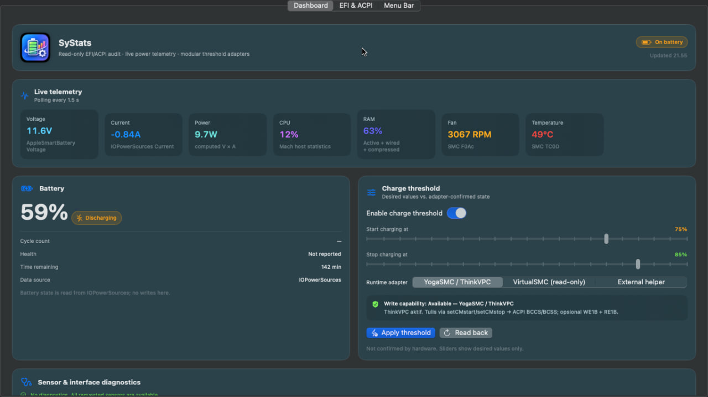
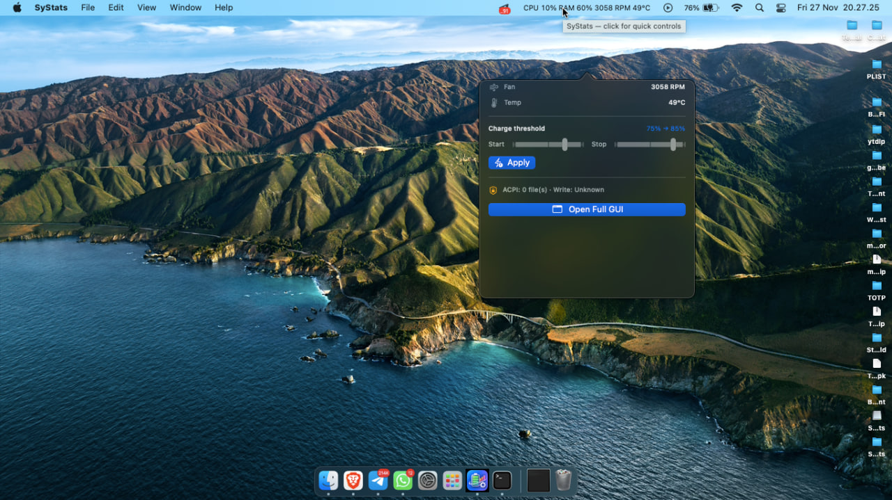
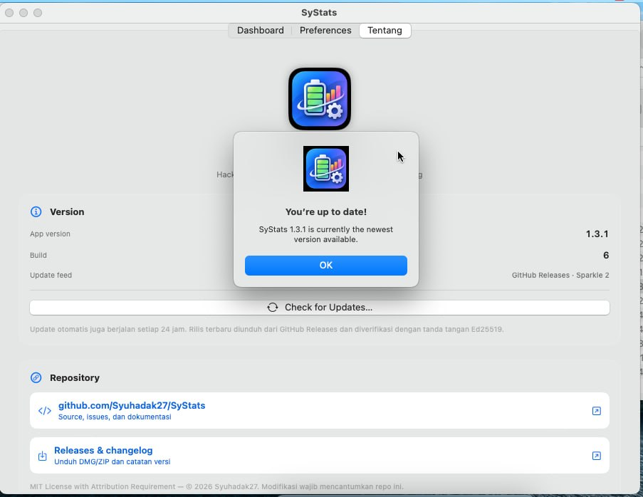
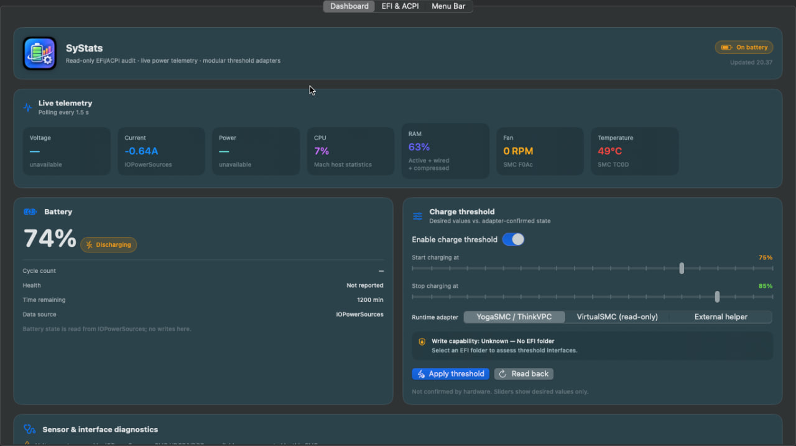

# SyStats

[](https://github.com/Syuhadak27/SyStats/actions/workflows/build-release.yml)
[](https://github.com/Syuhadak27/SyStats/releases)
[](https://github.com/Syuhadak27/SyStats)
[](LICENSE)

SyStats adalah aplikasi menu bar native untuk macOS pada sistem Hackintosh. Aplikasi ini menampilkan telemetri daya secara langsung, mengatur batas pengisian baterai, dan memeriksa file EFI/ACPI tanpa mengubahnya.

## Fitur

- Telemetri langsung: tegangan, arus, daya, penggunaan CPU dan RAM, kecepatan kipas, serta suhu.
- Batas pengisian baterai (Start/Stop) melalui YogaSMC/ThinkVPC, dengan opsi direct EC dan helper eksternal.
- Item menu bar yang dapat diatur: pilih metric, ubah label, aktifkan/nonaktifkan, dan ubah urutan.
- Pemeriksaan EFI/ACPI otomatis di latar belakang; hasilnya ditampilkan sebagai status singkat, bukan sebagai menu tersendiri.
- Pembaruan otomatis melalui Sparkle 2 dan GitHub Releases.
- Build universal untuk Intel (`x86_64`) dan Apple Silicon (`arm64`), dengan target macOS 13 Ventura atau lebih baru.

## Screenshots

**Dashboard saat charger terpasang**


**Dashboard saat menggunakan baterai**



**Editor menu bar**


**Popover menu bar**



**Tab Tentang dan pengecekan update**



**Kondisi sebelum pembacaan tegangan/arus diperbaiki**



## Instalasi

1. Unduh `SyStats-<versi>.dmg` dari halaman [Releases](https://github.com/Syuhadak27/SyStats/releases).
2. Buka DMG tersebut dan seret `SyStats.app` ke folder Applications.
3. Klik kanan `SyStats.app`, pilih **Open**, lalu konfirmasi **Open** sekali lagi.

Aplikasi ditandatangani secara ad-hoc dan belum dinotarisasi. Pada macOS 15 atau lebih baru, jika tetap diblokir, buka **System Settings → Privacy & Security** dan pilih **Open Anyway**. Sebagai alternatif, jalankan:

```bash
xattr -cr "/Applications/SyStats.app"
```

## Penggunaan

### Batas pengisian baterai

Buka Dashboard, aktifkan **Enable charge threshold**, lalu atur nilai Start dan Stop. Tekan **Apply** untuk menulis nilai ke adapter yang terdeteksi. Nilai slider menunjukkan nilai yang diinginkan; status "Applied & verified" hanya muncul jika adapter berhasil melakukan read-back.

Rentang nilai adalah 0–100%, Stop harus lebih besar dari Start, dengan jarak minimal 5%.

### Menu bar

Tab **Menu Bar** menyediakan preset (Automatic, Always AC, Always Battery), daftar item yang dapat diatur, label bebas, dan separator. Perubahan langsung diterapkan pada status item.

## Cara kerja

### Sumber telemetri

| Data | Sumber utama | Catatan |
|---|---|---|
| Kapasitas baterai | `IOPowerSources` | Sumber yang sama dengan ikon baterai macOS |
| Tegangan dan arus | `kIOPSVoltageKey`, `kIOPSCurrentKey`, lalu `AppleSmartBattery` | Fallback SMC digunakan bila keduanya tidak tersedia |
| Daya | `V × \|A\|`, atau SMC/adapter watt | Daya baterai, bukan konsumsi sistem |
| CPU | `host_statistics(HOST_CPU_LOAD_INFO)` | Dihitung dari selisih antar sampling |
| RAM | `host_statistics64(HOST_VM_INFO64)` | Perkiraan memori terpakai |
| Kipas dan suhu | SMC `F0Ac`, `TC0D`, `TC0P`, `TN0P` | Bergantung pada kext yang aktif |

Nilai yang tidak tersedia ditampilkan sebagai `—` disertai diagnostik, bukan diganti dengan data contoh.

### Pemeriksaan EFI

`EFIDetector` mencari folder EFI pada path tersimpan, `/Volumes/EFI/EFI`, `/Volumes/ESP/EFI`, `~/Desktop/EFI`, `~/EFI`, dan folder `EFI` relatif. File `.aml` dan `.dsl` dipindai di `OC/ACPI`, `APPLE/ACPI`, dan `ACPI`.

Pemeriksaan hanya membaca file. Tabel ACPI, method terkait baterai/EC/thermal/fan/SMC, dan status kext dari `config.plist` dipakai untuk menentukan kemampuan sistem. Method yang ada di dalam AML tidak dianggap otomatis dapat dipanggil dari ruang pengguna macOS.

### Adapter threshold

- **YogaSMC/ThinkVPC** menulis properti `setCMstart` dan `setCMstop` yang diteruskan ke method ACPI `BCCS`/`BCSS`.
- **Direct EC** menggunakan `YogaSMCUserClient` untuk `WE1B`/`RE1B`. Offset harus diisi manual dan diverifikasi oleh pengguna; fitur ini default nonaktif.
- **VirtualSMC** bersifat read-only dan tidak mengklaim write.
- **External helper** menjalankan executable yang ditentukan pengguna dengan argumen Start dan Stop.

Reapply berkala dan notifikasi perubahan charger menjaga nilai tetap konsisten setelah charger dicolok atau dicabut.

## Build dari sumber

Proyek Xcode dihasilkan oleh XcodeGen dan di-build oleh GitHub Actions. Tidak diperlukan build lokal.

```bash
brew install xcodegen
xcodegen generate --spec project.yml --project .
xcodebuild -project SyStats.xcodeproj -scheme SyStats \
  -configuration Release -destination 'platform=macOS' \
  ARCHS='x86_64 arm64' CODE_SIGNING_ALLOWED=NO
```

Workflow `build-release.yml` melakukan generate, build universal, verifikasi bundle, ad-hoc codesign, packaging ZIP/DMG, dan publikasi GitHub Release saat tag `v*` di-push.

## Struktur proyek

```text
Sources/              Kode Swift
Assets.xcassets/      AppIcon dan MenuBarIcon
Config/Info.plist     Konfigurasi bundle
images/               Screenshot untuk README
project.yml           Spesifikasi XcodeGen
.github/workflows/    Build dan release otomatis
EFI/                  Referensi lokal, tidak ikut version control
```

## Pembaruan

Feed Sparkle tersimpan di `appcast.xml`. Kunci privat Ed25519 disimpan sebagai GitHub Secret `SPARKLE_PRIVATE_KEY`. Lihat `UPDATING.md` untuk prosedur penyiapan dan rilis.

## Lisensi

MIT License dengan kewajiban atribusi. Lihat [LICENSE](LICENSE).

> Based on SyStats — https://github.com/Syuhadak27/SyStats
